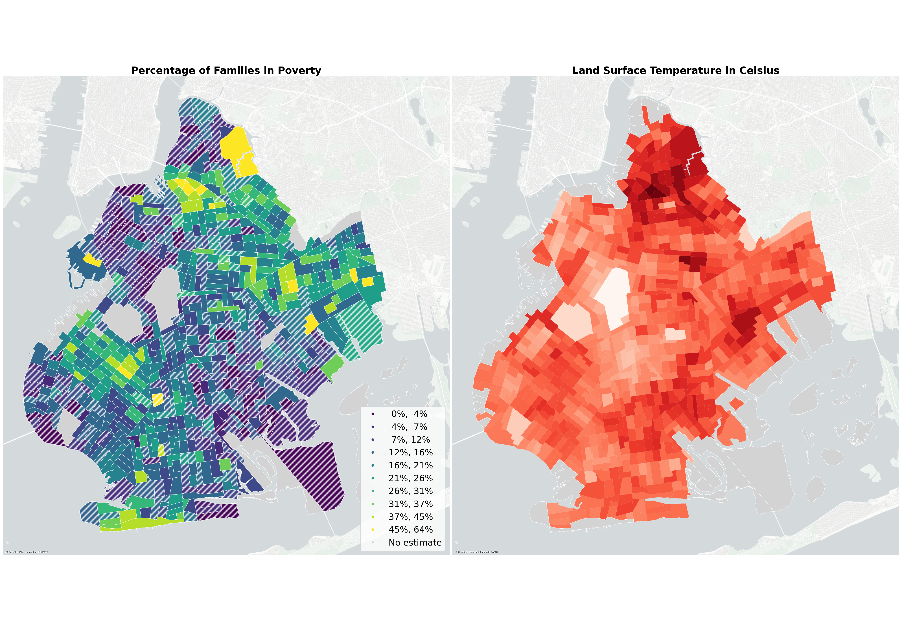
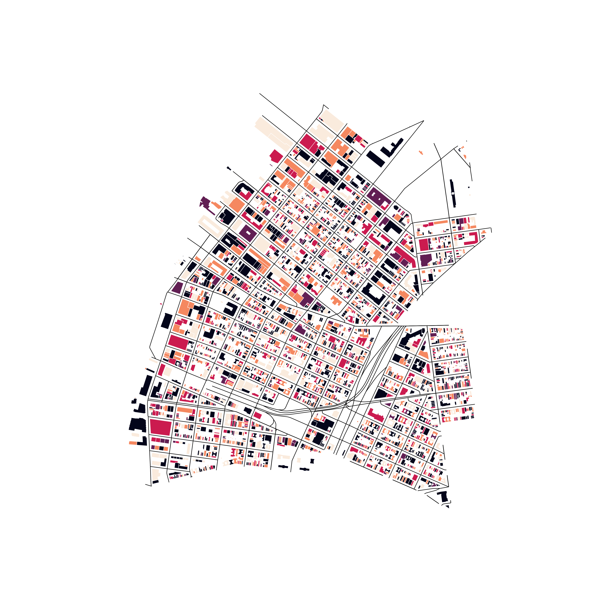
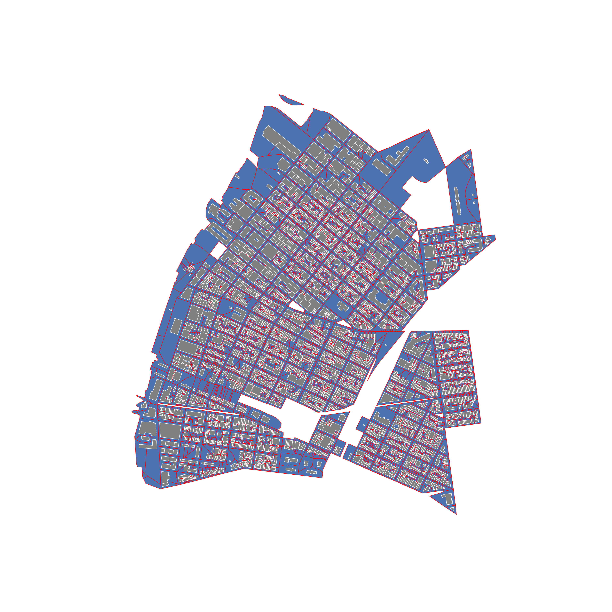

# Heat and Urban Form in Brooklyn

Where is Brooklyn hottest, and who lives there? And does the form of the city (the size, shape and arrangement of buildings, blocks and streets) help explain surface heat, building by building?

Final project for *Command Line GIS*, Rutgers, Fall 2022.

  

<em>Family poverty rate (left) and land surface temperature (right), by census tract.</em>

## What it does

1. **Rasters to places** ([`cgis_finalproject_rasters.ipynb`](cgis_finalproject_rasters.ipynb))
   Zonal statistics of satellite-derived land surface temperature, NDVI (greenness) and albedo (reflectivity) for census tracts, neighborhood tabulation areas and every building footprint (15 m buffer).
2. **Heat and who lives there** ([`cgis_finalproject_mapping.ipynb`](cgis_finalproject_mapping.ipynb))
   - joins tract-level ACS 2019 race and poverty data from the Census API
   - correlations, side-by-side maps and interactive Folium maps
3. **Measuring urban form** ([`cgis_finalproject_morphometry_v1.ipynb`](cgis_finalproject_morphometry_v1.ipynb), [`_v2`](cgis_finalproject_morphometry_v2.ipynb))
   - builds a morphological tessellation, tessellation-based blocks and building-to-street links with `momepy`
   - measures building, block and street characteristics, then their spatially lagged distributions
   - adapts Fleischmann et al.'s numerical taxonomy of urban form (*Environment and Planning B*, 2022)
4. **Urban form types** ([`cgis_finalproject_clustering.ipynb`](cgis_finalproject_clustering.ipynb))
   - PCA, then k-means and Gaussian mixture models (number of clusters chosen by BIC)
   - groups buildings into form types
5. **Heat and form** ([`cgis_finalproject_econometrics.ipynb`](cgis_finalproject_econometrics.ipynb))
   - building-level regression of land surface temperature on form and land-cover variables
   - spatial diagnostics (Moran's I, Lagrange multiplier tests) with `spreg`

**Tract-level correlations:**

- Hotter tracts are less green (r = −0.42).
- Hotter tracts are somewhat poorer (r = 0.20).
- Share non-white is close to uncorrelated with surface temperature (r = 0.03).

  
  

<em>Building form clusters (left) and the morphological tessellation they are measured on (right).</em>

## Notes

- Notebook outputs are cleared to keep the repo small. The data (building footprints, street network, rasters, about 3.5 GB) are not included.
- The Census API calls need your own [key](https://api.census.gov/data/key_signup.html).

## Stack

Python · GeoPandas · rasterio · rasterstats · momepy · OSMnx · libpysal · spreg · scikit-learn · factor_analyzer · statsmodels · Folium · contextily
